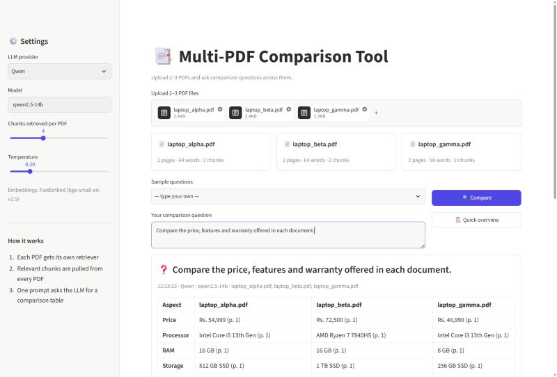

# Multi-PDF Comparison Tool (PS 35)

**Problem statement:** Comparing several documents is tedious. Upload 2–3 PDFs and ask comparison questions across them.

**Approach:** Each PDF gets its own FAISS retriever → for a question, the top chunks are retrieved from *each* PDF separately → one prompt asks the LLM to answer as a comparison table (one column per document, "Not mentioned" when a PDF lacks the info).

## Features
- Upload 2–3 PDFs; each gets its own FAISS retriever so no document is left out
- Comparison table + key differences + summary, with page citations
- "Not mentioned" instead of guessing (reduces hallucination)
- One-click **Quick overview** of all documents
- Sample questions, history of all comparisons in the session
- Download each answer as Markdown, CSV or Excel
- Sources panel showing exactly which passages were used
- Default LLM: self-hosted Qwen 2.5 14B (OpenAI-compatible llama.cpp server); Groq, Gemini and Ollama still selectable
- Answers stream in live; clear errors when the server is unreachable, the key is wrong (401) or a request times out
- Works offline for retrieval: falls back to keyword vectors if the embedding model can't download
- Clear errors for scanned, blank, password-protected or invalid PDFs; auto-retry on rate limits

## Tech stack
- Python, Streamlit (UI)
- LangChain + FAISS (one vector store per PDF), pypdf for text extraction
- FastEmbed `BAAI/bge-small-en-v1.5` embeddings (free, runs locally on CPU)
- LLM: Qwen 2.5 14B via an OpenAI-compatible endpoint (default), Llama 3.3 70B via Groq, Gemini 2.5 Flash, or a local Ollama model

## How to run
**Quick start (Windows):** double-click `run.bat` (Mac/Linux: `./run.sh`), then add your key to `.env`.

**Manual:**
```bash
python -m venv venv
venv\Scripts\activate          # Windows  (Mac/Linux: source venv/bin/activate)
pip install -r requirements.txt
copy .env.example .env         # then paste your GROQ_API_KEY into .env
streamlit run app.py
```
**LLM configuration** (in `.env` or the environment):

| Variable | Default | Meaning |
|---|---|---|
| `LLM_PROVIDER` | `Qwen` | Default provider |
| `LLM_BASE_URL` | `http://127.0.0.1:18205/v1` | OpenAI-compatible server URL |
| `LLM_MODEL` | `qwen2.5-14b` | Model name |
| `LLM_API_KEY_ENV` | `QWEN_API_KEY` | Name of the environment variable that holds the key (the key itself is never stored in `.env`) |
| `LLM_TIMEOUT` | `600` | Request timeout in seconds |
| `LLM_MAX_TOKENS` | `1500` | Max answer length |

For Groq, set `GROQ_API_KEY` (free key at https://console.groq.com/keys).

## Usage
1. Upload 2–3 PDFs (try the ones in `sample_pdfs/`).
2. Pick a sample question or type your own, e.g. *"Compare the price, features and warranty."*
3. Click **Compare** → comparison table, key differences, summary, and the passages retrieved from each PDF.

## Project structure
```
app.py                  Streamlit UI
src/pdf_compare.py      PDF loading, per-PDF retrievers, prompt, LLM call
sample_pdfs/            3 sample laptop spec sheets
tests/                  sample PDF generator + pipeline test (pytest)
```

## Tests
```bash
pytest -q
```
8 tests: indexing, per-PDF retrieval, prompt building, bad/blank PDF handling, table export, and a full UI flow test.

## Docker
```bash
docker build -t pdf-compare . && docker run -p 8501:8501 --env-file .env pdf-compare
```

## Screenshots
Real outputs from Qwen 2.5 14B on the three sample PDFs (more in `screenshots/`).




